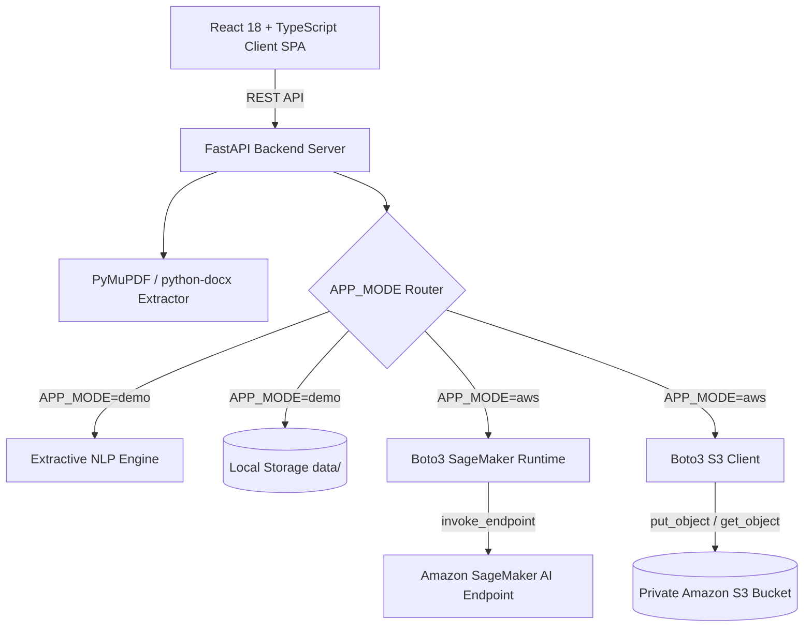

# DocuMind AI: Intelligent Document Summarizer on AWS S3 + SageMaker AI

[](https://fastapi.tiangolo.com)
[](https://react.dev)
[](https://aws.amazon.com/s3/)
[](https://aws.amazon.com/sagemaker/)
[](LICENSE)

An enterprise-grade, cloud-native full-stack application that ingests PDF, Word DOCX, and TXT documents, extracts digital content, generates AI summaries using Amazon SageMaker AI inference endpoints, and securely manages document and summary objects in private Amazon S3 buckets.

> **Zero-Cost Demo Mode Included**: The platform works completely offline without AWS credentials or cloud billing by switching to Demo Mode (`APP_MODE=demo`).

---

## 1. Project Introduction & Overview

**DocuMind AI** bridges the gap between state-of-the-art cloud machine learning models and end-user productivity. Built as a college mini project in Cloud Computing and Machine Learning, the system allows users to upload documents, configure their preferred summary length and output format, preview extracted text, and generate high-fidelity summaries.

### Key Highlights
- **Multi-Format Ingestion**: Supports `.pdf`, `.docx`, and `.txt` files with strict server-side validation.
- **Dual-Mode Architectural Engine**:
  - **AWS Production Mode (`APP_MODE=aws`)**: Real-time Amazon SageMaker AI inference + Amazon S3 storage.
  - **Local Demo Mode (`APP_MODE=demo`)**: Offline Extractive NLP engine + local filesystem persistence.
- **Parametric Summarization**:
  - Length: **Short** (~75-150 words), **Medium** (~200-350 words), **Detailed** (~400-600 words).
  - Format: **Paragraph**, **Bullet Points**, **Key Takeaways**.
- **Long Document Chunking**: Automatic sliding-window chunking (800 words with 50-word overlap) ensures long documents do not exceed model token windows.
- **Persistence & Audit History**: Stores summary metadata and clean plaintext files with search, view, and deletion capabilities.
- **Zero-Secret Security**: No AWS keys or credentials in client bundles or API responses.

---

## 2. System Architecture



---

## 3. Project Structure

```
CC project backlog atharva/
├── backend/
│   ├── app/
│   │   ├── api/
│   │   │   ├── __init__.py
│   │   │   └── routes.py              # REST API endpoints (/preview, /summaries, /config)
│   │   ├── core/
│   │   │   ├── __init__.py
│   │   │   └── config.py              # Pydantic BaseSettings & environment loader
│   │   ├── models/
│   │   │   ├── __init__.py
│   │   │   └── schemas.py             # Pydantic v2 validation models
│   │   ├── services/
│   │   │   ├── __init__.py
│   │   │   ├── extractor.py           # PyMuPDF, python-docx, TXT extractors
│   │   │   ├── demo_summarizer.py     # Local extractive NLP engine
│   │   │   ├── sagemaker_service.py   # SageMaker runtime adapter & chunking
│   │   │   └── storage_service.py     # S3 & Local storage abstractions
│   │   ├── __init__.py
│   │   └── main.py                    # FastAPI entrypoint with CORS & error handlers
│   ├── tests/
│   │   ├── __init__.py
│   │   ├── test_extractor.py          # Extraction unit tests
│   │   ├── test_summarizer.py         # Demo summarizer unit tests
│   │   ├── test_storage.py            # Storage CRUD tests
│   │   ├── test_aws_services.py       # Mocked SageMaker & S3 tests
│   │   └── test_api.py                # FastAPI TestClient API tests
│   ├── requirements.txt
│   ├── .env.example
│   └── .env
├── frontend/
│   ├── src/
│   │   ├── components/
│   │   │   ├── Navbar.tsx             # Top bar with AWS status indicator
│   │   │   ├── Sidebar.tsx            # Navigation & capability specs
│   │   │   ├── FileUpload.tsx         # Drag-and-drop & preview drawer
│   │   │   ├── SummarySettings.tsx    # Length & format controls
│   │   │   └── SummaryCard.tsx        # Results, copy, download TXT, key points
│   │   ├── pages/
│   │   │   ├── Dashboard.tsx          # Metrics, recent summaries, architecture card
│   │   │   ├── SummarizePage.tsx      # Main summarization workflow
│   │   │   ├── HistoryPage.tsx        # Persistent history table & deletion
│   │   │   └── SettingsPage.tsx       # Live cloud diagnostics & guide
│   │   ├── services/
│   │   │   └── api.ts                 # Axios backend service
│   │   ├── types/
│   │   │   └── index.ts               # TypeScript schemas
│   │   ├── App.tsx                    # Main application router
│   │   ├── main.tsx
│   │   └── index.css                  # Tailwind styles
│   ├── package.json
│   ├── tailwind.config.js
│   └── vite.config.ts
├── docs/
│   ├── architecture.md                # System design & sequence diagrams
│   ├── aws-setup.md                   # Step-by-step AWS S3 & SageMaker guide
│   └── project-report.md              # 18-section academic project report
├── README.md
└── .gitignore
```

---

## 4. Prerequisites

- **Python 3.10+ / 3.11+ / 3.13**
- **Node.js v18+ / v20+** and **npm**
- *(Optional for AWS mode)*: AWS Account & AWS CLI configured via `aws configure`

---

## 5. Quick Start (Demo Mode - Zero AWS Billing)

By default, the application runs in **Demo Mode**, requiring zero cloud setup.

### 1. Start the Backend
```bash
# Navigate to backend directory
cd backend

# Install dependencies
pip install -r requirements.txt

# Run the FastAPI server
python -m uvicorn app.main:app --reload --port 8000
```
Backend API will be live at: `http://localhost:8000` (API Docs: `http://localhost:8000/docs`).

### 2. Start the Frontend
```bash
# Open a new terminal and navigate to frontend directory
cd frontend

# Install dependencies
npm install

# Start development server
npm run dev
```
Frontend web application will be live at: `http://localhost:5173`.

---

## 6. How to Configure AWS Mode

When ready to test live AWS infrastructure:

### Step 1: Create a Private Amazon S3 Bucket
```bash
aws s3api create-bucket --bucket documind-summaries-<YOUR-ACCOUNT-ID> --region us-east-1
aws s3api put-public-access-block --bucket documind-summaries-<YOUR-ACCOUNT-ID> \
  --public-access-block-configuration "BlockPublicAcls=true,IgnorePublicAcls=true,BlockPublicPolicy=true,RestrictPublicBuckets=true"
```

### Step 2: Deploy Amazon SageMaker Summarization Endpoint
Deploy a pre-trained transformer model (e.g. `facebook/bart-large-cnn`) via the SageMaker JumpStart console or Python script:
```python
# deploy.py
from sagemaker.huggingface import HuggingFaceModel
import sagemaker

role = sagemaker.get_execution_role()
hub = {'HF_MODEL_ID': 'facebook/bart-large-cnn', 'HF_TASK': 'summarization'}
huggingface_model = HuggingFaceModel(transformers_version='4.37.0', pytorch_version='2.1.0', py_version='py310', env=hub, role=role)
predictor = huggingface_model.deploy(initial_instance_count=1, instance_type='ml.m5.xlarge', endpoint_name='documind-summarizer-endpoint')
```

### Step 3: Update `backend/.env`
```env
APP_MODE=aws
AWS_REGION=us-east-1
S3_BUCKET_NAME=documind-summaries-<YOUR-ACCOUNT-ID>
SAGEMAKER_ENDPOINT_NAME=documind-summarizer-endpoint
SAGEMAKER_PAYLOAD_FORMAT=huggingface
```
Restart the FastAPI backend. Navigate to the frontend **Settings** page to see the AWS connection status change to **Connected**.

---

## 7. Running Backend Unit Tests

Run the complete test suite (includes tests for extraction, validation, demo summarization, S3 mocking, and SageMaker response adapters):

```bash
cd backend
python -m pytest tests/ -v
```

All tests pass without requiring active AWS credentials.

---

## 8. Security & Cost Best Practices

- **Never Commit Secrets**: AWS Access Keys are omitted from `.env.example` and source control. Use IAM instance profiles in EC2/ECS.
- **Private S3 Enclosure**: S3 buckets are 100% private with default SSE-S3 encryption.
- **Teardown SageMaker Endpoints**: Delete endpoints when finished to avoid hourly idle fees:
  ```bash
  aws sagemaker delete-endpoint --endpoint-name documind-summarizer-endpoint
  ```

---

## 9. Academic Documentation

For college project submission and review:
- Complete 18-Section Project Report: [`docs/project-report.md`](docs/project-report.md)
- Detailed Cloud Architecture: [`docs/architecture.md`](docs/architecture.md)
- AWS Deployment Playbook: [`docs/aws-setup.md`](docs/aws-setup.md)
