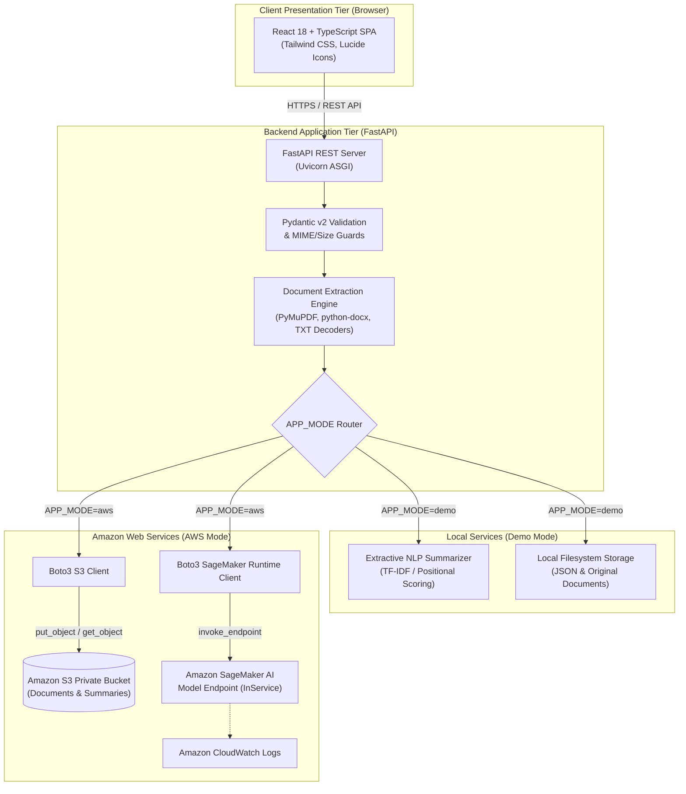
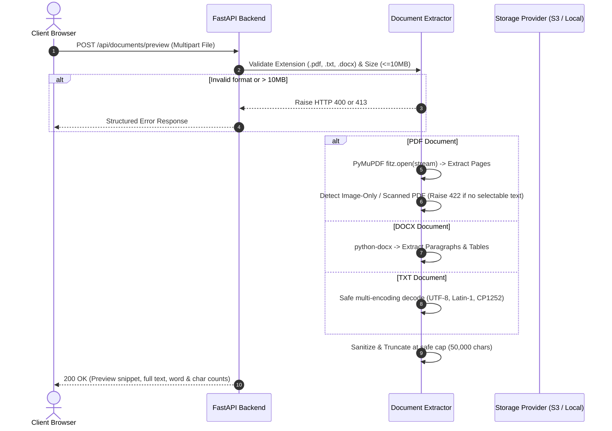
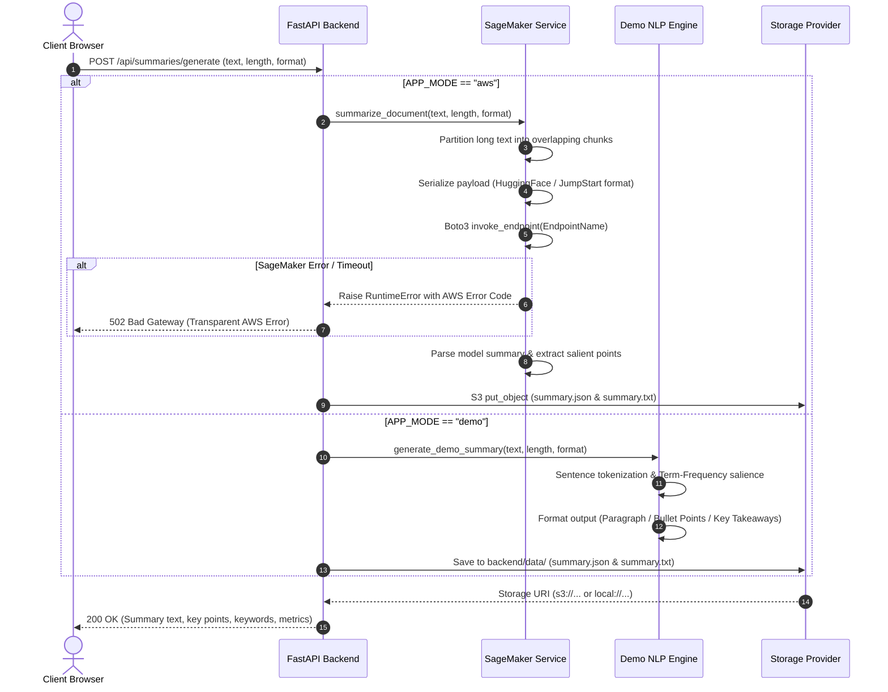

# System Architecture: Intelligent Document Summarizer (DocuMind AI)

## 1. High-Level Architecture

DocuMind AI is architected as a cloud-native, decoupled full-stack platform designed to summarize business, legal, and academic documents reliably. It features a **dual-mode operational engine**:
1. **AWS Production Mode**: Connects to **Amazon S3** for secure object storage and **Amazon SageMaker AI** for deep learning inference.
2. **Demo Mode**: Completely self-contained offline mode providing extractive NLP summarization and local file persistence, suitable for testing and classroom evaluation.



---

## 2. Data Flow & Sequence Workflows

### A. Document Upload & Extraction Workflow



---

### B. Summarization & Persistence Workflow



---

## 3. Storage Hierarchy

Amazon S3 objects (and mirrored local storage folders) are partitioned by a unique UUID `document_id` rather than trusting client-supplied file paths:

```
s3://<S3_BUCKET_NAME>/
├── documents/
│   └── <document_id>/
│       └── original.<pdf|txt|docx>   [Content-Type, Metadata: original-filename]
└── summaries/
    └── <document_id>/
        ├── summary.json              [Structured metadata, metrics, key points]
        └── summary.txt               [Clean plaintext representation]
```

### Security Considerations:
- **No Path Traversal**: User-supplied filenames are never used as S3 object keys or filesystem paths.
- **Private Access**: The S3 bucket disables public access (`BlockPublicAcls`, `BlockPublicPolicy`, `IgnorePublicAcls`, `RestrictPublicBuckets`).
- **Encrypted at Rest**: Uses server-side encryption (SSE-S3 or SSE-KMS).
- **Preserved Metadata**: Original filename and MIME types are stored strictly within object metadata tags.

---

## 4. Amazon SageMaker Model Adapter & Long-Document Chunking

SageMaker endpoints vary in their payload specifications. The service provides an adaptable interface:
- **HuggingFace Pipeline Format** (e.g. `facebook/bart-large-cnn`, `google/flan-t5-large`):
  ```json
  {
    "inputs": "<chunk_text>",
    "parameters": {
      "min_length": 90,
      "max_length": 250,
      "do_sample": false
    }
  }
  ```
- **JumpStart LLM Prompt Format** (e.g. `meta-vllm-llama-3-8b-instruct`):
  ```json
  {
    "inputs": "Instruction: Summarize as organized bullet points.\nDocument:\n<chunk_text>\n\nSummary:",
    "parameters": {
      "max_new_tokens": 300,
      "temperature": 0.3
    }
  }
  ```

### Map-Reduce Chunking Strategy for Documents:
1. Documents exceeding 800 words are partitioned into sliding windows with a 50-word overlap to maintain contextual continuity across chunk boundaries.
2. Each chunk is submitted to the inference endpoint.
3. Intermediate summaries are aggregated and normalized into the requested style (`paragraph`, `bullet_points`, or `key_takeaways`).
